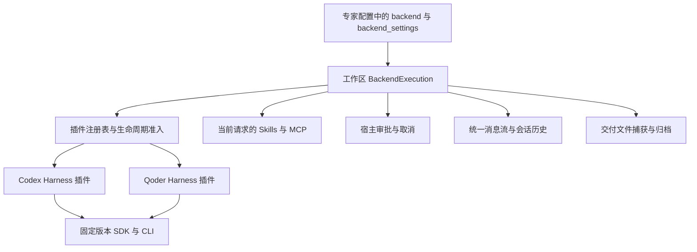

# 2026-11-14 上游合并复核

本次在已合并的 `f47dd19bd1442b989eeb8df8d146cbbab572d0b1` 上继续复核。远端查询确认上游 `main` 仍指向该提交。本周 32 个提交的逐项解释继续保存在 `docs/UPSTREAM_MERGE_2026-11-13.md`，本报告补充第二次复核发现、实际接入方式、使用影响和本轮验证。

复核前的 HEAD 为 `d0cd740c75bcf4d66a85d1102e312420b80d2e64`。用户当时的暂存树为 `e59863354a42665be459ca711d784a72827dd15b`，工作内容保存在 `refs/codex/pre-upstream-review-2026-11-14`。本轮修正独立提交，原有未提交功能、暂存状态和本地可视化数据继续保留。

## 本轮发现并补齐的遗漏

上一轮合并完成了插件化主体及结构化引用兼容。本轮再次检查实际安装入口、桌面锁和聊天页面后，确认还有以下遗漏。

| 遗漏 | 本轮修正 | 对使用的影响 |
| --- | --- | --- |
| `[test]` 仍直接安装 Qoder SDK | 移除该条直接依赖，插件继续声明固定版本 SDK | 核心测试环境可以真实验证 SDK 缺席，Codex 单独测试环境能够保持隔离 |
| 桌面入口仍选择 `.[local,qoder]` | 改为 `.[local]`，使用旧锁版本偏好重新解析 | 桌面默认核心移除 Qoder SDK，使用 Qoder 时由插件安装准备依赖 |
| Harness 专项 CI 的 push 分支没有 `lobehub-style` | 将当前分支加入原工作流 | 此分支后续相关提交可以触发核心及三平台厂商插件测试 |
| 上一轮整理 SDK 静态导出时丢失显式重导出 | 恢复所有公开符号的类型检查重导出 | 仓库外插件作者可以在严格类型检查下导入 `PluginContext` 等公开类型，运行时继续惰性解析 |
| Qoder 的 `tools` 配置只生成权限规则，没有完整限制 CLI 可见工具 | 同时生成 `includeTools`／`excludeTools`，空白名单和全部禁用的服务不传给 CLI | 默认及绕过审批模式均携带明确的工具范围 |
| Codex 只有白名单时才过滤禁用工具 | 无白名单时同样生成 `disabled_tools` | 已解析的显式禁用规则可以抵达真实 app-server 配置 |
| Windows 超长读租约可以写入，却被扫描端误判为不存在 | 统一租约目录创建、扫描与退出清理的扩展路径处理 | 活动进程的读租约继续阻止依赖维护，进程退出后正确释放 |
| 实际挂载的引用组件缺少上游快捷键 | 接入 `Alt+Shift+Q`，兼容按物理 `KeyQ` 识别 macOS 键盘字符 | 鼠标与键盘使用同一份结构化引用草稿 |
| 选择文本时 `.trim()` 删除首行缩进 | 原样保留选择文本，仅对空白判断使用 `.trim()`，统一换行符 | Python 等代码首行缩进保留 |
| 正文跨代码块时被宿主复制工具栏拒绝 | 为宿主两类代码块工具栏增加明确标记，沿用其禁止选中文字样式 | 可以连续引用正文和代码，其他交互控件继续接受边界检查 |
| 系统消息也带有可引用回答标记 | 仅给 assistant 消息添加回答来源标记 | 系统通知不会被当作 Agent 回答引用 |
| 聚焦引用按钮时 selectionchange 会关闭操作，切换作用域可能留下短暂旧选择 | 聚焦时保留操作，当前选择绑定专家和会话作用域 | 支持键盘操作，切换会话后快捷键不会带入旧选择 |

桌面锁由 251 项变为 250 项。唯一移除项是 `qoder-agent-sdk==1.0.9`，其余包版本全部相同，无新增包。锁仍保留完整哈希和跨平台条件。SymPy、Tokenizers、NumPy、Pandas、SciPy、XTGeo、Word、Excel、PowerPoint 和 PDF 依赖均有回归断言。此前已有的可选 `[ml]` 和 `[full]` 约定继续沿用。

本机 Windows Qoder SDK 附带的 `qodercli.exe` 为 159,742,448 字节，约 152.3 MiB。桌面核心移除该依赖后，这个程序由按需插件依赖提供。完整安装包的最终压缩体积仍需通过对应平台的正式构建测量。

## 第三方 Agent 的实际调用链



### 安装、减重和惰性启动

Codex 和 Qoder 已分别抽为 `plugins/harness/codex` 与 `plugins/harness/qoder`。两者有独立清单、依赖、设置前端、测试和可安装 ZIP。插件包使用公开宿主 SDK，前端通过 `host.fetch` 取得认证和当前专家上下文。

核心和桌面默认安装不再携带厂商运行时。保留的 `qwenpaw[codex]`、`qwenpaw[qoder]` 用于准备过渡依赖。使用相应后端还需要安装、启用对应 Harness 插件。插件注册和后端列表读取只登记元数据，实际操作时才创建工作区实例、解析 CLI 并打开 SDK 客户端。

二次开发使用公开的 `qwenpaw.plugins.harnesses` 接口。旧 `qwenpaw.harnesses.*` 内部导入需要迁移到公开接口或相应插件实现。仓内调用已同步调整，仓库外安装真实 wheel 的作者回归验证了公开导入、严格类型和后端注册流程。

实例按工作区、插件注册代次和实例设置管理。每次调用重新绑定 session、user、channel、cwd 及审批上下文。插件更新、禁用或卸载经过原生命周期和活动任务准入，旧上下文失效后无法继续操作资源。关闭实例会等待 SDK、子进程和审批的清理。

### 旧专家、旧会话与升级操作

专家原有的 `backend` 和 `backend_settings` 保留。后端缺失、禁用或启动失败时，设置页面仍显示已保存的选择和状态。运行返回明确的 `backend_unavailable`，用户可以修复插件后继续使用同一专家。

会话映射迁移到工作区 `plugin-data/qwenpaw-harness-*/`。首次实际打开时，如果新位置不存在，先验证旧 `harnesses/*_sessions.json` 再原子复制。旧映射文件保留，新位置已有有效内容时优先使用它。损坏内容会报告错误。映射按可信 user、channel 和 session 身份隔离，旧格式映射只会被一个明确身份认领。

宿主的 `HarnessSessionBridge` 继续把消息写入统一会话存储，保留本分支已有的 Console 轮次标记、元数据与文件引用。禁用和卸载插件后的专家配置、已落盘历史、插件数据及厂商账号均继续保留。

旧内置后端升级需要准备对应的已验证插件包和依赖。现有共享迁移命令支持先预览再应用。

```powershell
qwenpaw plugin migrate-legacy-harnesses --plugin-dir <已验证的本地插件包目录> --dry-run
qwenpaw plugin migrate-legacy-harnesses --plugin-dir <已验证的本地插件包目录> --apply
```

迁移只处理已有专家实际使用的后端，尊重显式禁用，重复执行保持幂等，并复用正式离线安装事务。准备目录中每个插件 ID 只放一个版本，避免同一插件的多个版本被判为重复输入。它会报告缺失依赖，准备过程保持离线且不启动插件。现行自动桌面更新尚未自动执行这项准备，旧用户升级后可能需要在插件管理中完成安装和依赖准备。本次没有修改用户正在使用的专家、账号或插件配置。

### Skills、MCP、科学工具与指派的影响

| 能力 | 实际处理 | 对我们现有使用方式的影响 |
| --- | --- | --- |
| 专家 Skills | 从当前工作区的有效技能集合解析，带文件内容修订投影给 SDK | 沿用专家和频道启用范围，技能更新可以使客户端配置失效并重建 |
| MCP | 解析启用的 MCP DriverCard、凭据、工具白名单和当前请求策略 | 使用当前专家的有效 MCP 配置，凭据与策略更新参与修订判断 |
| Codex 和 Qoder 的工具执行 | 交给厂商 SDK 的执行器和配置 | 终端、文件操作及权限模式遵循对应后端设置 |
| UGSci 原生科学工具与 FlowForge 函数工具 | 继续从原生工具注册和原生执行入口调用 | 当前 Harness 能力解析只投影 Skills 与 MCP，需要在第三方后端使用这些工具时，通过已有 MCP 服务提供相应接口 |
| `@Agent`、直接指派、共同协作和原生循环 | 继续由已有原生后端入口处理 | `usesQwenPawBackend` 的功能范围在合并前已经存在，第三方后端显示自己的模型、命令和权限选项 |
| ACP 外部 Agent 委派 | 继续沿用独立的外部 Agent 服务入口 | 此次 Codex／Qoder 插件化不改变既有 ACP 连接流程 |
| 引用回答 | 宿主统一消息渲染、草稿和提交链处理 | 原生后端与第三方后端均可使用，实际内容随该轮输入送给选中的后端 |

Skills 是说明和执行资源，某些技能需要的宿主专用函数仍取决于上述工具入口。启用技能后，第三方 SDK 可执行的具体操作还要看其工具和有效 MCP 配置。

### MCP 工具范围的第二次修正

Qoder SDK 的 MCP `tools` 字段会被转换成权限规则，实际 `mcp-config` 使用 `includeTools` 和 `excludeTools` 限定工具范围。本轮保留原权限规则，同时传递过滤字段。显式白名单只包含允许项，显式禁止的名称进入排除列表。空白名单以及白名单全部被禁止的服务从本次配置中移除。原有 `strict_mcp_config` 继续限定 MCP 配置来源。相关字段及权限模式的官方说明见 [Qoder MCP 参考](https://docs.qoder.com/cli/mcp-reference) 和 [Qoder SDK 权限](https://docs.qoder.com/cli/sdk/permissions)。

Codex 现在将显式禁用项稳定排序后写入 `disabled_tools`，即使该服务未声明白名单也执行。已有 `enabled_tools` 继续传入，厂商配置在允许列表之后应用禁止列表。配置字段说明见 [Codex 配置参考](https://learn.chatgpt.com/docs/config-file/config-reference)。

新增 Qoder 14 项参数化用例，通过正常 `run_turn` 入口调用真实已安装 SDK 的 CLI 配置序列化，覆盖默认审批、绕过审批、白名单、默认拒绝和显式拒绝。新增 Codex 8 项用例，经正常后端入口检查真实 SDK 的 app-server 参数，覆盖常规权限和 full-access。新增用例在修正前分别复现 10 项及 4 项失败，修正后全部通过。最终两个完整插件文件分别通过 27 项和 17 项。

宿主当前只对显式声明了工具名的 MCP 服务逐工具解析用户／频道等细粒度策略。这一行为在合并前已存在。服务未声明工具清单时只得到服务默认策略，因此需要此类细粒度控制的服务应配置工具清单。本轮修正保证已解析的范围传到厂商 CLI，动态发现后的完整细粒度策略仍需后续能力支持。第三方 SDK 的本地工具、用户配置和权限模式也各有自己的入口。

两个 Harness 插件版本均从 `1.0.0` 升为 `1.0.1`，避免同版本包替换。已重建各自前端，实际 ZIP 回归核对清单版本及打包后的投影源码，并通过正式 `Host.install`、注册与调用。新包位于 `dist/plugins/harness/qwenpaw-harness-codex/qwenpaw-harness-codex-1.0.1.zip` 和对应 Qoder 目录，旧版本包保留。本次任务目录的独立目录索引已生成，工作区原发布目录索引继续由正式全量打包流程生成。

### 审批与交付文件

插件的审批请求绑定本次调用的公开 `request_approval` 回调。完成、取消或过期的调用失去审批资格，退出时回收待决审批。Codex 默认配置使用 workspace-write 和 on-request，Qoder 保留其权限模式选择。用户显式选择厂商 full-access 模式后，SDK 按该权限模式运行。

上游 Office COM 防护接入原生 shell 工具入口。第三方 SDK 使用自己的命令执行器，适用其沙箱和审批设置。报告与界面应据实际后端说明执行权限。

本分支交付文件功能已移接到实际 `BackendExecution.stream` 外层。在 response created 后读取本轮 cwd 与绑定项目根，调用真实 `begin_turn_files`。运行中的工具事件记录活动，完成、失败、取消及流提前关闭均执行最终捕获，最后等待底层流清理。宿主消息渲染继续显示文件摘要、预览和归档入口。覆盖对应多项目根、历史回放、取消和生成器关闭行为的原有测试继续登记在完整清单。

## 引用回答的实际处理

聊天页面实际挂载的是 `AnswerQuoteComposer`。保留本分支的结构化引用数据、独立问题输入、文件／终端来源与草稿机制，将上游选区交互接入这个页面组件。上游独立 `QuoteSelection` 的原有用例继续保留。

### 选择和写入草稿

1. 只接收聊天消息区内同一条 assistant 回答的非空选区。
2. 排除输入框、可编辑内容、iframe、系统通知以及控件起止点。跨正文与宿主代码块时允许经过禁止选择文字的代码工具栏。
3. 点击悬浮按钮或按 `Alt+Shift+Q`，共同调用结构化引用写入逻辑。中文输入法组合输入和额外 Ctrl／Meta 修饰不会误触发。
4. 保存消息 ID、原选中文本和来源身份，保留代码缩进。问题输入框已有文字保持原样。
5. 引用草稿按专家和聊天作用域隔离并持久保存，支持预览、移除及文件／终端来源跳转。每轮最多 12 条，总计 32,000 字符。

### 发送、排队和指派

实际发送入口先保存本次提交的输入、附件、专家／会话身份和引用快照。引用通过 `qwenpaw_answer_quotes` 元数据与格式化上下文一起传入消息。原生 `@Agent` 的路由分析使用用户的提交文本。引用原文包含 `@Other` 或 `/new` 时，保留为引用内容。

如果当前任务仍运行，引用和附件随该条队列项保存。只有被本次准入接受的引用快照会消费掉，状态检查期间新加入的引用继续留在草稿。草稿切换、重试、编辑、后台队列和历史回放继续使用现有机制。

新增的实际聊天页回归通过正常 `beforeSubmit` 和请求入口检查引用内容、代码缩进和指派行为。真实 SDK 消息组件回归检查正文、代码块、系统消息和第三方插件控件的选区边界。

### 真实浏览器补充验证

使用真实 Chromium、真实 `HostResponseCard`、真实代码块组件和 `AnswerQuoteComposer`，由浏览器原生 Range 和 Selection 连选正文、Python 代码和后续段落。

原生选区与最终结构化引用逐字相同，保留 `    indented()` 的四空格缩进，未包含代码工具栏的语言名和复制文字。快捷键添加成功，原问题文字保留，切换会话后旧选区不会加入新草稿，页面错误为零。证据保存在 `.codex-tmp/upstream-review-2026-11-14/quote-browser-proof.json` 和同目录截图。

## 底层与轻量化改动复核范围

| 范围 | 当前接入情况 |
| --- | --- |
| Windows 扩展 SQLite 路径和 HTML 本地路径解码 | 使用统一转换器与解码路径，保留本分支历史及预览入口 |
| 共享依赖中断恢复、原子发布和频道更新依赖保留 | 与本分支来源校验、操作身份、确认／取消及回滚事务合并 |
| 频道慢启动诊断、解释器和 ABI 探测、飞书原生库加载 | 接入实际 worker 启动链，保留真实子进程及依赖回归 |
| Harness 插件注册、工作区实例、SDK 拆分和 CI | 主体已合入，本轮补齐 test extra、桌面锁和当前分支触发 |
| 计划任务跟踪与会话完成刷新 | 保留 TaskTracker 与本分支持久队列准入衔接 |
| shell 意图标题、Whisper 模型配置、布尔 additionalProperties | 保留上游行为及对应回归 |
| Office COM 执行防护和卷根 ACL 防护 | 保留上游检查，沿用对应原生执行入口 |
| 桌面减重、独立频道运行包和插件运行包 | 桌面默认核心移除厂商 SDK，保留离线科学工具链及频道闭包 |
| 签名、真实组件包内容与本地数据排除 | 原更新器、发布门禁和 UGSci 数据排除继续执行 |

## 本轮测试与复核结果

完整前端清单为 241 个文件。后端清单追加依赖配置回归和安装锁文件后为 259 个文件，更新器清单为 54 个文件。保护清单及其原有关键用例保留，新用例追加到各自门禁。

前端修正前的完整基线执行得到 233 个文件、3492 项通过，另 8 个文件因独立工作树缺少忽略的插件构建产物和依赖链接而未能收集。补齐同源产物及链接后的完整 8 文件复验有 116 项通过、2 项超时，随后这两个完整文件的 61 项全部通过。最终基线覆盖 241 个文件、3610 项。

修正后的完整前端执行得到 240 个文件通过、1 个文件失败，3614 项通过、1 项 HTML 资源加载超时。该完整文件随后独立复验 9 项全部通过，最终覆盖全部 241 个文件、3615 项，包含本轮新增的 5 项引用回归。类型检查和全 Console 格式检查通过，生产构建及品牌、Monaco CSS、预压缩和首屏体积门禁通过，首屏为原始 9.09 MiB、Brotli 2.33 MiB。

真实 wheel 在仓库外安装后完成 SDK 验证，严格作者类型检查、9 项公开 Harness SDK 用例、无厂商 SDK 的原生应用导入、模板导出与真实加载／重载／调用全部通过。Codex 和 Qoder 的真实 CLI `--version` 分别报告 `0.144.4` 与 `1.0.47`。Qoder Python SDK 固定版本仍为 `1.0.9`。wheel 的 core、test、full 依赖均无厂商 SDK，wheel 和 sdist 均排除了 UGSci 本地可视化数据。此处构建用于 SDK 与包内容验收，正式桌面发行仍通过现有发布流程生成。

原始失败日志和后续完整文件复验分开保存。开发时新增用例的失败复现也保留。后端通过原验证脚本核对完整清单，再逐文件使用独立 pytest 进程和独立真实依赖协调目录执行，每个文件内的真实 worker 共享该文件的协调目录。PyInstaller 文件使用实际无厂商 SDK 的解释器，厂商插件文件使用安装了其真实固定 SDK 的解释器。

完整回归中，频道重启测试遇到了 Windows 复用 PID。日志显示旧 worker 与已重建的新 worker 取得相同 PID，原断言把数字相同判为旧进程存活。修正为重启前保存 `psutil.Process` 身份，重启后验证旧身份已退出、新进程存活且身份不同，同时继续检查代次递增、配置保存及密钥字段。真实 worker 生命周期断言继续执行。

读租约诊断进一步复现了 262 字符路径的扫描遗漏。普通路径打开得到 `FileNotFoundError`，同一个文件通过 Windows 扩展路径打开后可确认仍被真实 worker 加锁。上一轮短协调目录的复验没有覆盖该边界。本轮修正了创建、扫描和清理，并新增跨平台、无跳过的真实子进程用例，检查长路径活动读者阻止维护、退出释放、陈旧租约清理及随后正常维护。完整安装锁文件得到 26 项通过、15 项原有平台条件跳过，新用例加入前述两个固定清单。

后端覆盖全部 259 个文件，最终完整文件证据汇总为 6579 项通过、66 项原有平台／环境条件跳过。原 258 文件执行有 4 个文件共 5 项失败，分别为流程完成等待、频道 PID 复用、shell 的两个进程时限及超长读租约漏检。频道身份与读租约问题已按前文修正。当前完整 worker 文件 78 项通过，当前完整频道宿主 60 项通过，流程结构化输出完整文件 86 项通过，shell 完整文件 107 项通过、13 项平台条件跳过。流程和 shell 的早期时限失败保留原日志，复验沿用原断言和时限。

更新器覆盖全部 54 个文件，最终为 832 项通过、36 项原有平台／环境条件跳过。原 53 文件执行有一次启动依赖修复超时，该完整文件另一次早期复验也触及 90 秒子进程时限。本轮后端完整清单内该文件通过，最终当前源码的完整 10 项再次通过。可重复的超时根因尚未确认，时限及来源准入均保留。一次本地专项运行将 pytest 临时目录与依赖协调目录重叠，触发活动租约清理错误，随后改用两个独立任务目录完成复验。

新增的安装锁文件以完整文件补入两个清单。文件级最终证据及每个文件的原始日志路径保存在 `.codex-tmp/upstream-review-2026-11-14/final-verification-evidence.json`。上述数字按每个清单的最终完整文件证据统计，包含首轮执行及明确记录的完整文件复验。

全 Console 格式检查通过，定向 ESLint 为零错误，保留组件文件导出辅助函数的一条既有 Fast Refresh 提示。全仓 pre-commit 首轮补齐 6 个 Python 文件的编码声明、逗号和排版，修正与原内容的 AST 相同。其中原有的两份 FlowForge `assistant_verification.py` 和 `test_conversations.py` 继续保留未提交状态。全仓 pre-commit 完整复验通过。后续 MCP 修正和新增测试另行执行最终 33 个相关文件的全部 pre-commit 检查，全部通过，日志保存在任务目录。

## 尚需实际环境验收的范围

真实厂商账号登录、联网模型回答、供应商服务端审批与工具执行仍需账号环境验收。本轮使用真实已安装 SDK 与合成协议事件验证接入行为，未发起付费模型请求。Windows 和 macOS 的正式安装包、真实自动升级交接及 macOS 原生选区交互仍需对应平台构建和实机验收。此前报告记录的安装路由间歇来源校验失败继续结合本轮完整结果记录，来源准入检查保留。
