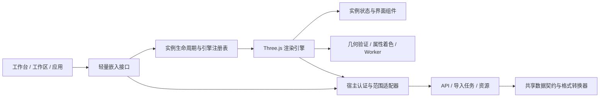

# UGSci 模块化可视化引擎

可视化工作台、工作区文件预览和应用内卡片复用同一套引擎。此模块负责已有数据的转换、显示、筛选和交互，不代替储层、井筒或管网计算器。可同时展示地质网格、层面、井轨迹和地面管网，并独立打开测井曲线。

## 模块边界



- `ui/src/visualization/index.ts` 注册路由、工作区渲染器以及 `QwenPaw.ugsci.visualization` 应用接口。
- `PluginPage.ts` 和 `WorkspaceRenderer.ts` 仅负责宿主范围、导入状态、挂载和销毁。`workspaceImport.ts` 区分任务终态失败、等待超时与请求失败；重试终态任务重新提交，瞬时请求失败重查原任务。
- `hostAdapter.ts` 捕获 Agent／会话／项目范围，每次请求读取当前凭证；只向当前可视化服务及工作区文件树发送这些凭证。宿主导航处理部署前缀，`useLocation` 支持同页数据集切换。
- `viewer/mount.tsx`、`engines/registry.ts` 定义引擎边界。`ThreeViewerEngine.ts` 为具体实现，`viewer/index.tsx` 仅注册和导出运行时。Three.js 仍按需加载。
- 每个引擎实例拥有独立 `ViewerStore`、请求控制器、Worker、定时器和 WebGL 资源。销毁一个预览不清空其他实例。通过 `onSelection` 向嵌入应用发送选择事件。
- `rendering/datasetGeometry.ts` 在创建 GPU 资源前验证二进制长度、有限坐标和索引边界；`scalarColors.ts` 为 Worker 和主线程提供相同着色算法。
- `ui/` 保存可独立验证的组件树、导入对话框、属性面板、菜单、切片播放器、布局和中文标签。语义字段保留稳定代码，展示名称与单位独立定义。

## 应用内嵌入

UGSci 插件加载后，其他应用可直接使用轻量接口，不需要复制查看器或引入另一份 Three.js：

```ts
const handle = await window.QwenPaw.ugsci.visualization.mount(container, {
  scope: { agentId, chatId },
  initialDatasetId: datasetId,
  compact: true,
  onSelection(selection) {
    // selection 为对象/单元标识及可选坐标；更新应用自己的详情面板。
  },
});
await handle.ready;
await handle.executeCommand("set-property", { property: "pressure" });

// 应用关闭卡片或切换项目时必须释放。
handle.dispose();
```

容器应有明确宽高和局部定位上下文。`mount` 返回的 Promise 表示运行时已挂载；`handle.ready` 表示目录和指定初始数据已完成加载，失败会拒绝 Promise。`executeCommand` 自行等待初始化。`dispose` 可重复调用，关闭后命令会拒绝。

`ViewerMountOptions` 还支持 `apiBase`、自定义 `request`、`headers`、`autoLoad`、`engineId`、`persistenceKey`。运行时 `registerEngine(id, factory)` 可注册符合 `EngineHandle` 的替代引擎；应用仍使用相同挂载、就绪与释放契约。宿主适配接口和纯运行时接口分开，因此独立使用时可以注入自己的数据服务。

场景和相机保存按服务地址及 Agent／会话／项目范围隔离；同一范围内希望分别保存的应用卡片应传入不同的稳定 `persistenceKey`。认证令牌不写入存储键。没有范围的历史独立查看器保留旧键；有明确范围的实例不自动读取归属未知的旧全局状态，也不删除旧状态。

嵌入默认 `autoLoad: false`、`enableCommands: false`，没有指定数据集时保持空场景。工作区预览明确关闭智能体命令总线；专用工作台显式启用。命令交互属于工作台行为，不能让所有应用卡片被广播命令一起切换。

工作台命令按宿主校验后的 Agent 分发：入队从可信执行上下文取得 Agent，HTTP 读取、回执和状态查询使用宿主 Agent 解析器。仅同一 Agent 的未完成命令去重；完成或失败后允许重新执行。同一 Agent 多个工作台仍可广播，跨 Agent 不能读取或确认他人的命令；这不代替用户／会话级权限模型。

## 共享数据契约

保留既有 `version: 1` 目录及 `files.positions/indices/cell_ids/scalars`，以增量字段描述新数据。旧网格和历史转换缓存继续兼容。

| 字段 | 含义 |
| --- | --- |
| `n_vertices / n_cells / n_indices` | 实际缓冲区数量，消费时校验 |
| `metadata.geometry_primitive` | `lines` 或 `triangles`，显式契约优先，不按可整除性猜测 |
| `metadata.scalar_association` | 默认 `point` 或 `cell` |
| `properties[name]` | `label`、`association`、`count`、`unit` 和 `no_data` |
| `metadata.vertices_per_cell / indices_per_cell` | 需要时描述管体等逻辑单元的几何分组 |
| `metadata.topology.nodes / edges` | 管网稳定节点标识、端点坐标、边标识、连接关系和逻辑单元编号 |
| `time_steps` | 动态属性资源；界面和 API 的 `time_step=0` 表示静态，正整数匹配 `step.index + 1` |

坐标采用 X 东向、Y 北向、Z 向上的约定；输入井轨迹的正向下 TVD 在转换时取反。明确米/英尺的 LAS 坐标转换为米，并保留源单位。未确认的单位不伪标为米，也不自动叠到空间井场景。GeoJSON 经纬度必须先投影，不能直接当平面米制坐标。

数值缺测以浮点 NaN 保存，JSON 详情返回 `null`，CSV 留空。渲染用灰色区分缺测与真实零值；全部缺测时不展示虚构数值范围。不能根据属性名猜压力、流量等工程单位；无源单位时 `unit` 为 `null`。

CSV、JSON、Arrow 管网使用同一转换器，线模型与管体保持相同坐标、拓扑及每段属性。统计、拾取和导出遵循当前时间步。井轨迹、LAS 曲线、层面及网格保留各自领域结构，不强制压成同一种单元模型。

## 质量与兼容性

本轮发现并修复的主要缺陷：

| 原有问题 | 修复与验证重点 |
| --- | --- |
| 页面与查看器耦合，全局状态及释放影响其他实例 | 宿主适配、实例状态、渲染注册表与轻量嵌入分离；实际多实例开关与释放回归 |
| 导入、目录、叠加请求晚到后覆盖新选择；失败任务无法正确重试 | 生命周期取消、加载代次检查、导入任务终态与网络失败区分 |
| Agent 工作台命令串扰；完成的相同命令被去重 | 可信 Agent 上下文与 HTTP 校验、按 Agent 分发和查询、仅未完成命令去重 |
| 管网线索引被误认三角形，管体丢失逐段属性，缺测变为零 | 显式几何和属性契约、稳定拓扑与单元标识、共享转换器、NaN／null 和缺测灰色 |
| LAS 无单位曲线导致列错位，单样本丢失，坐标单位及高程不一致 | 保留列顺序和最后样本，源单位与米制转换分开；GeoJSON 保留全部轨迹和有符号高程 |
| 井筒颜色没有进入实际管体，选中后改变色带含义 | 颜色绑定到真实管体顶点，选择高亮不再染色覆盖属性色 |
| 属性缓冲区加载后被清空，筛选和详情与显示不一致 | 保留加载属性，统计、拾取、导出统一时间步 |
| 程序打开对象后页签停留在旧领域，测井可能空白 | 数据加载后静默同步领域视图，重访页签保留已选对象，避免递归切换 |
| 英文内部字段直接显示、键盘不可达、窄容器面板遮挡模型 | 中文标签、真实按钮和可访问页签、组件搜索展开、容器断点、视角适配与 HUD 布局 |
| 场景与相机保存使用全局键 | 按服务和 Agent／会话／项目及应用命名空间保存，保留旧独立查看器状态 |

新增回归纳入 `console/scripts/verify-fork-features.mjs`：

- `visualizationEmbedding.test.tsx` 加载两份实际 bootstrap 产物并挂载注册页面，验证宿主范围、初始化、重试、导航、路由变化及命令确认重试。
- `visualizationEngine.test.ts` 构造真实引擎，仅替换 GPU 边界，验证两个实例、实际几何/属性/过滤、异步生命周期、缺测、井筒着色和视角适配。
- `oilgasViewerUi.test.ts` 验证实际 DOM 组件与导入请求路径，包括键盘、中文、分页竞态、伴随文件匹配和布局。

后端回归保留在 `test_visualization_core.py`、`test_visualization_well_placement.py`、`test_visualization_run_center_bridge.py`，关键用例纳入 `scripts/fork_backend_suites.json`。运行前端固定回归、两套 TypeScript 检查、完整后端固定清单，并构建与同步插件镜像。

浏览器验收使用 `deliverables/visualization-engine-qa/` 内真实转换器生成的纯合成数据，覆盖地质网格、层面、井轨迹、测井、管网线和管体。不能用这些合成样本宣称已验证所有商业软件格式或工程数据。

开发源为 `plugins/bundle/ugsci`；通过 `scripts/sync_ugsci_bundle.py` 同步 `src/qwenpaw/plugins_bundle/ugsci` 及生成产物。`visualization/data` 仍只供本地测试，不进入镜像或发布包。

## 尚未覆盖的边界

- 自动 CRS 投影、任意工程单位换算和不同坐标基准的数据自动拼接。
- 任意完井工具、复杂多分支井筒、气藏—井筒—地面管网耦合求解；本引擎展示其结果，不自行生成模拟结果。
- 浮点资源当前主要采用 float32；大坐标下亚米级精度需要后续 float64 或持久局部原点协议，显示时原点重定位不能恢复存盘已丢精度。
- 可选解析依赖未安装时的真实 Arrow、DLIS、VTK 等文件全覆盖验证，以及超大生产模型的性能验收和桌面安装包实测。
- 数据目录沿用本机插件存储，不等同于多租户数据隔离。新建远程共享服务需单独设计资源归属和权限模型。
