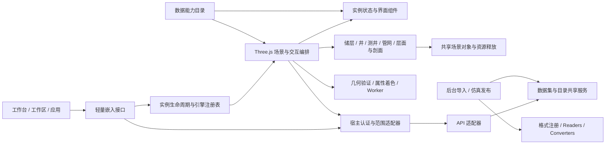

# UGSci 模块化可视化引擎

可视化工作台、工作区文件预览和应用内卡片复用同一套引擎。此模块负责已有数据的转换、显示、筛选和交互，不代替储层、井筒或管网计算器。可同时展示地质网格、层面、井轨迹和地面管网，并独立打开测井曲线。

## 模块边界



- `ui/src/visualization/index.ts` 注册路由、工作区渲染器以及 `QwenPaw.ugsci.visualization` 应用接口。
- `PluginPage.ts` 和 `WorkspaceRenderer.ts` 仅负责宿主范围、导入状态、挂载和销毁。`workspaceImport.ts` 复用 `viewer/api/importJobs.ts` 的任务观察器，区分任务终态失败、等待超时与请求失败；重试终态任务重新提交，瞬时请求失败重查原任务。
- `hostAdapter.ts` 捕获 Agent／会话／项目范围，每次请求读取当前凭证；只向当前可视化服务及工作区文件树发送这些凭证。宿主导航处理部署前缀，`useLocation` 支持同页数据集切换。
- `viewer/mount.tsx`、`engines/registry.ts` 定义引擎边界。`ThreeViewerEngine.ts` 负责场景、相机、请求、选择和工作台交互，领域对象创建委托给 `features/`；`viewer/index.tsx` 仅注册和导出运行时。Three.js 仍按需加载。
- 每个引擎实例拥有独立 `ViewerStore`、请求控制器、Worker、定时器和 WebGL 资源。销毁一个预览不清空其他实例。通过 `onSelection` 向嵌入应用发送选择事件。
- `rendering/datasetGeometry.ts` 在创建 GPU 资源前验证二进制长度、有限坐标和索引边界；`scalarColors.ts` 为 Worker 和主线程提供相同着色算法。
- `ui/` 保存可独立验证的组件树、导入对话框、属性面板、菜单、切片播放器、布局和中文标签。语义字段保留稳定代码，展示名称与单位独立定义。

## 领域能力与场景资源

领域能力仍属于 UGSci，并在同一个查看器运行时内组合。`viewer/capabilities/datasetProfile.ts` 统一描述数据集的领域、组件树分组、默认及支持视图、选择类型、空间叠加资格和几何原语；导航、组件树和渲染分派复用该描述。`capabilities/views.ts` 保留既有六个工作台视图，不因拆分代码增加入口。

| 领域模块（相对 `viewer/features/`） | 实际职责 |
| --- | --- |
| `reservoir/reservoirObject.ts` | 六面体角点整理、表面三角化、单元边线和筛选后的填充／边线同步；不修改调用者的原始位置数组 |
| `wells/wellObject.ts` | 空间井轨迹的管体、井名标签、点属性到管体顶点的着色和线框 |
| `welllog/wellLogObject.ts` | 保留深度测井的数据与几何缓冲区供测井视图消费，不为无空间位置的数据生成井场对象 |
| `network/networkObject.ts` | 显式管段线与已有管体表面的分派；兼容旧管网退化三角形编码，保留真实管体三角形 |
| `surfaces/surfaceObject.ts` | 层面与生成剖面的线／三角形对象；保留输入拓扑 |

`scene/createDatasetObject.ts` 为主数据集和叠加数据集提供相同的创建入口。保留完整六面体的 I/J/K 切片仍使用储层几何处理，但导航到剖面视图。空间 LAS/DLIS 可在井筒和测井视图之间切换；明确为 `depth-only` 的日志不加入空间叠加。历史无来源或未知来源目录仍保留储层回退行为，显式几何和属性元数据优先。

各领域返回 `DatasetObject`，提供着色、透明度、线框、可见单元和 `dispose`，并持有原始索引、局部坐标、原点及必要的边线。`scene/` 管理公共线／面对象、坐标重定位和 GPU 资源释放；释放会去重处理几何与材质，清理标签 DOM，并释放未挂到场景树的源几何。每个 handle 可重复释放，其他实例继续可用。

当前领域模块随同一份 `viewer-runtime` 加载；它们可独立验证和扩展，但尚未分别拆成下载包或独立服务。井轨迹仍使用现有自有管体实现；VidEx 的演示不代表已接入生产完井结构渲染。

扩展能力时，先在数据契约与能力目录描述来源、几何和空间语义，再在对应 `features/` 下实现领域对象，由统一工厂接入主场景与叠加场景。领域对象只接收数据和渲染参数，不读取宿主、请求 API 或引擎内部状态；资源通过 `DatasetObject` 统一释放。新增格式同时更新共享格式目录及后端 reader／converter，补充真实转换、实际引擎挂载与双份插件回归。接入井身结构组件时，完井数据适配和组件资源管理应放在井领域内，共享当前依赖和嵌入契约。

## 共享导入与后台服务

`ui/src/visualization/imports/formats.ts` 是前端共享格式目录，集中定义扩展名、MIME、主文件顺序、同模型伴随文件和工作区预览资格。工作区注册与导入对话框共同使用它；普通 CSV 继续使用宿主表格预览，管网 CSV 需显式导入。后端继续沿用 `file_artifacts` 转换注册表和 `visualization/backend/formats.py`，各 reader 与 converter 保留自己的领域解析职责。

`viewer/api/importJobs.ts` 的 `waitForImportJob` 供工作区预览和显式导入共用。观察器验证任务编号、状态和完成结果，规范进度，并在请求及等待期间响应 `AbortSignal`。停止观察只结束当前实例的等待，不取消后台任务，也不自动重新提交；超时与传输错误仍可查询原任务。明确失败或取消的终态由 `ImportJobFailedError` 表达，原有重试入口据此决定重新提交。

后端 `visualization/backend/services/` 不依赖 HTTP 或查看器工具：

- `datasets.py` 统一时间步属性选择、point／cell 归属、资源描述和文件枚举。静态属性可补足动态帧；未知时间步仍由 API 映射为原来的 404，不能静默读取错误快照。
- `catalog.py` 统一目录可见性、受管资源级联清理、派生数据元数据和 manifest 发布。`DatasetStore` 协议接受本地及仿真叠加目录；同一 manifest 路径沿用共享锁与原子替换。
- `api.py` 保留路由、请求模型、参数及旧 helper 委托；`jobs/manager.py` 和 `simulation.py` 直接调用共享服务，不再反向导入 HTTP 模块。现有 15 个工具名称与参数、注册入口和资源 schema 保持兼容。

目录仍区分插件本地 `data/bin` 与运行时 `ugsci/visualization/bin`。`SimulationCatalog` 保留仿真目录覆盖规则，派生结果继承 `simulation_run_id`；本轮不迁移缓存或建立新的按领域物理目录。删除内置示例仍仅隐藏，受管导入按原有父子关系删除资源；资源路径继续由 `ResourceStore` 校验。

后台取消与 manifest 发布仍在导入任务的同一把锁下排序，持久化完成状态先于暴露内存终态。已取消任务不能再发布目录或晚到事件；转换器内部计算是否能立即停止仍取决于原有执行机制。宿主认证、工作区路径解析及 Agent 命令范围不随服务抽取改变。

## 应用内嵌入

UGSci 插件加载后，其他应用可直接使用轻量接口，不需要复制查看器或引入另一份 Three.js：

```ts
const handle = await window.QwenPaw.ugsci.visualization.mount(container, {
  scope: { agentId, chatId },
  initialDatasetId: datasetId,
  compact: true,
  onSelection(selection) {
    // selection 为对象/单元标识及可选坐标；更新应用自己的详情面板。
  },
});
await handle.ready;
await handle.executeCommand("set-property", { property: "pressure" });

// 应用关闭卡片或切换项目时必须释放。
handle.dispose();
```

容器应有明确宽高和局部定位上下文。`mount` 返回的 Promise 表示运行时已挂载；`handle.ready` 表示目录和指定初始数据已完成加载，失败会拒绝 Promise。`executeCommand` 自行等待初始化。`dispose` 可重复调用，关闭后命令会拒绝。

`ViewerMountOptions` 还支持 `apiBase`、自定义 `request`、`headers`、`autoLoad`、`engineId`、`persistenceKey`。运行时 `registerEngine(id, factory)` 可注册符合 `EngineHandle` 的替代引擎；应用仍使用相同挂载、就绪与释放契约。宿主适配接口和纯运行时接口分开，因此独立使用时可以注入自己的数据服务。

场景和相机保存按服务地址及 Agent／会话／项目范围隔离；同一范围内希望分别保存的应用卡片应传入不同的稳定 `persistenceKey`。认证令牌不写入存储键。没有范围的历史独立查看器保留旧键；有明确范围的实例不自动读取归属未知的旧全局状态，也不删除旧状态。

嵌入默认 `autoLoad: false`、`enableCommands: false`，没有指定数据集时保持空场景。工作区预览明确关闭智能体命令总线；专用工作台显式启用。命令交互属于工作台行为，不能让所有应用卡片被广播命令一起切换。

工作台命令按宿主校验后的 Agent 分发：入队从可信执行上下文取得 Agent，HTTP 读取、回执和状态查询使用宿主 Agent 解析器。仅同一 Agent 的未完成命令去重；完成或失败后允许重新执行。同一 Agent 多个工作台仍可广播，跨 Agent 不能读取或确认他人的命令；这不代替用户／会话级权限模型。

## 共享数据契约

保留既有 `version: 1` 目录及 `files.positions/indices/cell_ids/scalars`，以增量字段描述新数据。旧网格和历史转换缓存继续兼容。

| 字段 | 含义 |
| --- | --- |
| `n_vertices / n_cells / n_indices` | 实际缓冲区数量，消费时校验 |
| `metadata.geometry_primitive` | `lines` 或 `triangles`，显式契约优先，不按可整除性猜测 |
| `metadata.scalar_association` | 默认 `point` 或 `cell` |
| `properties[name]` | `label`、`association`、`count`、`unit` 和 `no_data` |
| `metadata.vertices_per_cell / indices_per_cell` | 需要时描述管体等逻辑单元的几何分组 |
| `metadata.topology.nodes / edges` | 管网稳定节点标识、端点坐标、边标识、连接关系和逻辑单元编号 |
| `time_steps` | 动态属性资源；界面和 API 的 `time_step=0` 表示静态，正整数匹配 `step.index + 1` |

坐标采用 X 东向、Y 北向、Z 向上的约定；输入井轨迹的正向下 TVD 在转换时取反。明确米/英尺的 LAS 坐标转换为米，并保留源单位。未确认的单位不伪标为米，也不自动叠到空间井场景。GeoJSON 经纬度必须先投影，不能直接当平面米制坐标。

数值缺测以浮点 NaN 保存，JSON 详情返回 `null`，CSV 留空。渲染用灰色区分缺测与真实零值；全部缺测时不展示虚构数值范围。不能根据属性名猜压力、流量等工程单位；无源单位时 `unit` 为 `null`。

CSV、JSON、Arrow 管网使用同一转换器，线模型与管体保持相同坐标、拓扑及每段属性。统计、拾取和导出遵循当前时间步。井轨迹、LAS 曲线、层面及网格保留各自领域结构，不强制压成同一种单元模型。

## 质量与兼容性

本轮发现并修复的主要缺陷：

| 原有问题 | 修复与验证重点 |
| --- | --- |
| 页面与查看器耦合，全局状态及释放影响其他实例 | 宿主适配、实例状态、渲染注册表与轻量嵌入分离；实际多实例开关与释放回归 |
| 导入、目录、叠加请求晚到后覆盖新选择；失败任务无法正确重试 | 生命周期取消、加载代次检查、导入任务终态与网络失败区分 |
| Agent 工作台命令串扰；完成的相同命令被去重 | 可信 Agent 上下文与 HTTP 校验、按 Agent 分发和查询、仅未完成命令去重 |
| 管网线索引被误认三角形，管体丢失逐段属性，缺测变为零 | 显式几何和属性契约、稳定拓扑与单元标识、共享转换器、NaN／null 和缺测灰色 |
| LAS 无单位曲线导致列错位，单样本丢失，坐标单位及高程不一致 | 保留列顺序和最后样本，源单位与米制转换分开；GeoJSON 保留全部轨迹和有符号高程 |
| 井筒颜色没有进入实际管体，选中后改变色带含义 | 颜色绑定到真实管体顶点，选择高亮不再染色覆盖属性色 |
| 属性缓冲区加载后被清空，筛选和详情与显示不一致 | 保留加载属性，统计、拾取、导出统一时间步 |
| 程序打开对象后页签停留在旧领域，测井可能空白 | 数据加载后静默同步领域视图，重访页签保留已选对象，避免递归切换 |
| 英文内部字段直接显示、键盘不可达、窄容器面板遮挡模型 | 中文标签、真实按钮和可访问页签、组件搜索展开、容器断点、视角适配与 HUD 布局 |
| 场景与相机保存使用全局键 | 按服务和 Agent／会话／项目及应用命名空间保存，保留旧独立查看器状态 |

新增回归纳入 `console/scripts/verify-fork-features.mjs`：

- `visualizationEmbedding.test.tsx` 加载两份实际 bootstrap 产物并挂载注册页面，验证宿主范围、初始化、重试、导航、路由变化及命令确认重试。
- `visualizationEngine.test.ts` 构造真实引擎，仅替换 GPU 边界，验证两个实例、实际几何/属性/过滤、异步生命周期、缺测、井筒着色和视角适配。
- `oilgasViewerUi.test.ts` 验证实际 DOM 组件与导入请求路径，包括键盘、中文、分页竞态、伴随文件匹配和布局。
- `visualizationCapabilities.test.ts` 验证领域分类、旧目录回退、空间井与深度日志分离及切片视图；`visualizationRenderers.test.ts` 验证真实 Three.js 几何、拾取、属性颜色、边线筛选和资源独立释放。
- `visualizationDomains.integration.test.ts` 通过真实引擎实例组合各领域与叠加，验证视图、着色和实例间释放；`visualizationImports.test.ts` 验证共享格式与观察器的取消、晚到完成、终态、超时和传输失败。
- `visualizationArchitecture.test.ts` 检查能力／格式目录和领域／场景模块的依赖边界，以及跨模块运行时循环依赖。

后端回归保留在 `test_visualization_core.py`、`test_visualization_well_placement.py`、`test_visualization_run_center_bridge.py`，关键用例纳入 `scripts/fork_backend_suites.json`。运行前端固定回归、两套 TypeScript 检查、完整后端固定清单，并构建与同步插件镜像。

`test_visualization_services.py` 对两份插件源码使用真实临时文件，覆盖无 HTTP 模块时的多井导入与发布、两个存储目录并发写入及安全清理、动态资源与静态属性回退的 HTTP 行为、仿真派生目录归属。`test_visualization_http_contract.py` 和 `test_visualization_tool_contract.py` 继续保护已有端点与工具行为。服务抽取前后的完整 OpenAPI 文档已比较一致。

2026-11-06 架构重构的后端全量记录为 **3993 通过、8 失败、41 跳过**。其中质量检查发现本轮六个 Python 文件被写为 CRLF，已将两份源码规范为 LF；质量检查与双份服务回归随后 **10 项通过**。另外七项 Matrix E2EE 测试因当前环境缺少加密依赖失败，未放宽或跳过测试；这次全量不能记为全部通过。原始记录与复核日志位于 `deliverables/visualization-architecture-2026-11-06/`。

最终前端固定清单 **144 套、2213 项全部通过**，清单保护自测 **9 项通过**；控制台及插件 TypeScript 检查、插件生产构建均通过。本轮相关 112 个源码、测试和清单文件在最终完整前端执行期间保持相同哈希。首轮前端因本地已有依赖链接断裂而中止，保留原始日志；按锁文件校验完整性并恢复现有 Three 与 3d-force-graph 包后，从新进程执行上述完整结果，没有调整依赖版本或测试标准。

本轮重构没有新增 npm 依赖。最终 `viewer-runtime.js` 为 726166 字节，Node 默认 gzip 为 191974 字节，较前一轮兼容整理后的运行时分别增加 1600 和 764 字节。两份源码及生成产物一致，本地 127 个源数据文件哈希不变，镜像数据目录没有文件。后端全量启动时清单为 176 套，最终登记为 177 套；新增服务与质量复核单独记录，不将不同轮次合并成一次完整全绿认证。

浏览器验收使用 `deliverables/visualization-engine-qa/` 内真实转换器生成的纯合成数据，覆盖地质网格、层面、井轨迹、测井、管网线和管体。不能用这些合成样本宣称已验证所有商业软件格式或工程数据。

本轮最终构建另经 `deliverables/visualization-architecture-2026-11-06/browser-smoke/` 验证七类合成场景：储层、井轨迹、管网线、层面、仅深度测井、管体及保留六面体的剖面。验收直接加载生产产物，检查自动页签选择、测井属性切换、销毁重建和资源失败后的恢复；使用内存传输适配器，未连接真实项目或商业模拟器。截图、控制台检查及零残留画布结果保存在同目录上级。

开发源为 `plugins/bundle/ugsci`；通过 `scripts/sync_ugsci_bundle.py` 同步 `src/qwenpaw/plugins_bundle/ugsci` 及生成产物。`visualization/data` 仍只供本地测试，不进入镜像或发布包。

## 尚未覆盖的边界

- 自动 CRS 投影、任意工程单位换算和不同坐标基准的数据自动拼接。
- 任意完井工具、复杂多分支井筒、气藏—井筒—地面管网耦合求解；本引擎展示其结果，不自行生成模拟结果。
- 浮点资源当前主要采用 float32；大坐标下亚米级精度需要后续 float64 或持久局部原点协议，显示时原点重定位不能恢复存盘已丢精度。
- 可选解析依赖未安装时的真实 Arrow、DLIS、VTK 等文件全覆盖验证，以及超大生产模型的性能验收和桌面安装包实测。
- 数据目录沿用本机插件存储，不等同于多租户数据隔离。新建远程共享服务需单独设计资源归属和权限模型。


## 2026-11-06 工作台功能面板重构

工作台使用“数据与图层 / 领域视图 / 对象与分析”三栏。数据目录按已有领域分类，只显示非空组；场景图层只列可见空间对象。来源关系只使用显式 `metadata.parent_dataset`，不根据同名井或文件名推测工程实体关联。空间井、深度测井、管网拓扑、属性和动态结果仍遵循原始领域契约。

对象选择、显隐和打开分析是独立动作：单击只检查元数据，复选框负责显隐，箭头或对象卡片的“打开分析”切换分析目标。选择使用原位 DOM 更新，保留键盘焦点和原生双击；双击聚焦并按需显示对象。明确打开分析时，原主对象转成拥有自身资源的叠加对象；坐标按其原点重新定位，保留几何、颜色、筛选与显隐。返回数据时恢复本次查看器会话中的属性、时间步、色带、透明度、边线、筛选及裁切设置。公开 `open` 命令仍保留原有加载语义，场景文件格式和宿主范围未变。

`ui/catalogOrganization.ts` 负责目录投影和来源，`componentTree.ts` 负责树渲染与原位选择；`contextInspector.ts` 只按能力配置移动原有控件，不替换输入节点、值和事件。右侧“对象 / 分析 / 场景”中仅显示适用操作；选中其他对象时不暴露作用于当前分析数据的输入。沿井剖面必须明确选择网格与空间井。导入、统计、切片、剖面、CSV、截图、场景导出与诊断均保留。

`ui/layout.ts` 统一 224px 数据栏、280px 检查栏、顶部工具、底部状态及浮层避让。窄屏默认折叠，并避免同时展开两侧遮满画布。空井位图、无网格的切片播放器和默认性能 HUD 不占用视场；基准测试与内存检查保留在场景诊断。工具栏收敛到适配、测距、撤销、重做、截图与更多菜单。

加载代次和选择版本分别保护模型加载与单元详情；旧请求不得覆盖新选择或用户在加载期间的显隐操作。切换模型会停止旧时间播放。裁切平面由各对象独立拥有，按对象世界矩阵更新以兼容原点变换和垂向缩放。图层隔离、全部显示和缓存显隐必须一致。加载失败时对象卡片可重试，卸载和目录删除仍通过完整资源 handle 释放。

新增五套回归进入固定清单：`visualizationCatalog`、`visualizationInspector`、`visualizationLayout`、`visualizationWorkbench.integration` 与 `visualizationWorkbench.races`。后两套构造真实引擎、几何和材质，仅隔离 GPU/命中等测试边界，覆盖跨领域选择、原对象保留、独立释放、坐标与裁切、快速切换、失败重试、显隐和详情竞态。验证原始记录位于 `deliverables/visualization-workbench-2026-11-06/`。

本轮没有新增 npm 依赖；未新增多轨测井、独立二维拓扑编辑器或替换生产井筒渲染器。工程实体关联需要后续补充明确的井 / 模型标识，不能用界面分组伪造数据关系。

本轮最终收尾（2026-11-07）：面板底部“重置当前分析”仅在选中当前分析对象时启用；空目录及仅深度测井的空间显隐按钮同步禁用。清空目录会停止时间步和切片播放、清除旧测井画面和选择状态。

最终构建后的可视化专项 **13 套、116 项全部通过**（包括真实嵌入、领域渲染、面板、竞态与原引擎）；控制台与插件类型检查、生产构建、12 项依赖兼容测试、9 项清单保护自测均通过。最终清单为 153 套，期间其他工作新增了测试；此前完整前端执行时为 149 套，结果为 2243 通过、1 项原生 CSV 预览超时，该嵌入套件独立复核 20/20 通过。不能把最终专项结果视为最终 153 套完整全绿。

后端完整执行为 4027 通过、13 失败、41 跳过：失败为 FlowForge 打包源码漂移 1 项、官方渠道包源码漂移 11 项、插件隔离替换生命周期 1 项。可视化相关 10 套随后 309/309 通过；生命周期单例复核 1/1 通过，未复现原失败，不据此宣称已修复全量失败。

最终查看器为 741755 字节，Python gzip level 9 为 194617 字节；双份源码及生成产物已逐项核对一致，右侧本地页面已加载最终查看器。127 个本地示例文件逐项 SHA256 与兼容整理阶段一致，镜像数据目录仍为 0 文件。官方镜像检查仍会报告测试生成的 Python 字节码缓存为多余文件；自动审批拦截其递归清理后保留了缓存，只读核验确认无其他漂移，没有修改排除规则或放宽检查。

浏览器验证覆盖实际页面的分析面板、合成数据的选择/打开与图层保留、测井属性切换及 390px 两侧面板互斥。现有宿主 `forwardRef` 开发警告仍存在；本轮未作宿主修复。详细记录见 [verification.json](../deliverables/visualization-workbench-2026-11-06/verification.json) 与 [实际页面截图](../deliverables/visualization-workbench-2026-11-06/workbench-final.png)。
